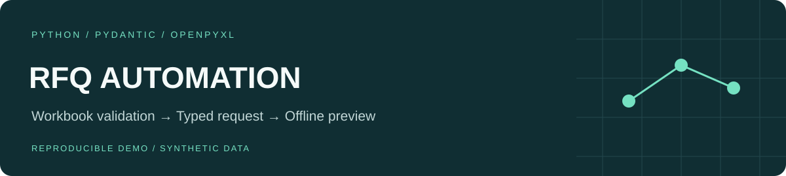
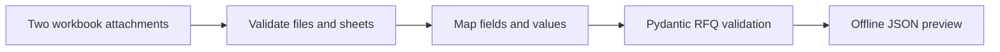

# RFQ Workflow Automation

A Python package that turns structured workbook attachments into validated request-for-quotation data, with explicit processing stages and an autonomous demonstration.

**All included examples are synthetic. The demo sends no email, creates no real tender and requires no working credentials.**

## Problem

Manually transferring fields from emailed spreadsheets into a procurement system is repetitive and error-prone. This project separates attachment validation, field mapping, request validation, API handling and reply composition so each stage can be checked independently.

## Run the offline example

Use Python 3.11+ in a virtual environment:

```sh
python -m pip install .
rfq-demo --output demo-output
```

The command generates two synthetic Excel workbooks, runs the **real workbook parser and mapping logic**, validates the result with Pydantic and writes `demo-output/rfq-preview.json`.

Choose an empty output directory: the demo refuses to overwrite existing files. You can also run `python -m api_integration.demo --output another-empty-folder`.

## Processing stages



The reusable package also includes IMAP/Exchange fetchers, REST adapters, retry handling, processing markers and reply composition. These adapters are provided for source review and controlled integration; the demo does not invoke them.

## Safety boundaries

- Identity mappings use fictional contacts, users and supplier groups.
- Original tender examples, recipient lists, corporate addresses and historical artifacts are excluded.
- The offline demo ignores `.env` and injects reserved example.com configuration.
- The scheduled live pipeline rejects execution unless `LIVE_INTEGRATIONS_ENABLED=true` is explicitly configured. Its process-locking entry point is Windows-specific.
- `dry_run` in the live pipeline is **not** an offline mode: its mail-fetch stage may still access the mailbox. Use `rfq-demo` for demonstration.
- Message folder names and duplicate attachment names are checked to keep outputs under the selected download directory. The attempted TLS-verification override was removed from the Exchange helper.

The lot reader currently checks workbook/sheet presence; complete validation of individual lot rows is not implemented. The demo does not claim to execute the live API or its business-side effects.

## Validation

```sh
python -m pip install '.[dev]'
python -m pytest
```

Tests cover workbook conversion, value mappings, API error handling with mocks, reply formatting, the offline example, explicit live-pipeline opt-in and attachment-path regression cases. A no-network check exercises the demo on actual generated `.xlsx` files.

## Code map

- `excel/`: workbook reading, validation and RFQ mapping.
- `sevenrights/api/`: typed request models and REST adapters.
- `mail/`: input transports, filename handling and reply composition.
- `pipeline.py`: live stage orchestration and Windows process locking.
- `demo.py`: the synthetic, network-free demonstration entry point.

This public edition is a reproducible portfolio example. It is not certified for a company's production mailbox or procurement system.
